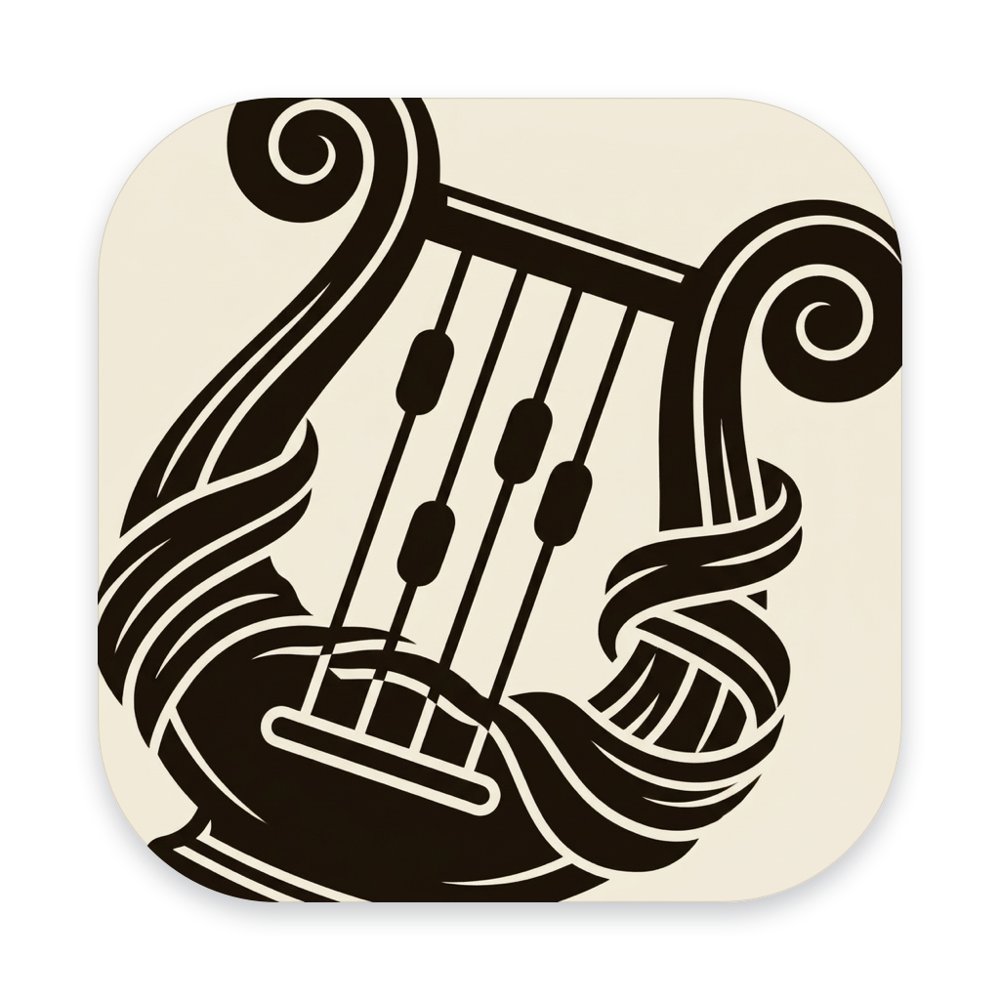

<p align="center">
  
</p>

<h1 align="center">Orfeus</h1>

<p align="center">
  <strong>A lightweight, native macOS menu-bar mixer for independent per-application volume control.</strong><br/>
  Built with Swift 6, SwiftUI, and Core Audio process taps — zero kernel extensions, zero virtual audio drivers, and zero telemetry.
</p>

<p align="center">
  <a href="https://github.com/berkaroon/Orfeus/raw/main/dist/Orfeus.dmg">
    
  </a>
  
  
  <a href="LICENSE">
    
  </a>
</p>

---

## Download & Install

- **Direct Download:** [**Orfeus.dmg**](https://github.com/berkaroon/Orfeus/raw/main/dist/Orfeus.dmg) (`2.1 MB`, Universal `arm64 + x86_64`)
- **SHA-256:** `74f76c9e72e794bbf9adcc2aef2da70fbfc46254f7ea3c7390e50909c72c0bd6`

### Installation Steps
1. Open **`Orfeus.dmg`** and drag **Orfeus.app** into your **Applications** folder.
2. **First Launch (Gatekeeper):** Because Orfeus is distributed independently with an ad-hoc signature and Hardened Runtime rather than a paid Apple Developer ID certificate, macOS may show an *"unverified developer"* warning on first launch. Open **System Settings → Privacy & Security**, scroll down, and click **Open Anyway** (or run `xattr -cr /Applications/Orfeus.app` in Terminal).
3. **System Audio Recording Permission:** Click the Orfeus lyre icon in the menu bar and move an app's slider. macOS may prompt for **System Audio Recording** permission at that moment so Core Audio process taps can adjust the app's volume locally.

---

## Features

- **Per-Application Volume Control:** Adjust each audio-producing app independently from the macOS menu bar using native sliders (`0%` mutes, `100%` restores normal unity volume and releases the tap).
- **Native Core Audio Process Taps:** Uses Apple's process-private `CATapDescription` and `AudioHardwareCreateProcessTap` APIs — no kernel extensions, DriverKit extensions, or HAL virtual drivers required.
- **Real-Time Click-Free Ramping:** Smooth per-buffer gain ramping via a lock-free C11 atomic handoff (`RTAtomic`), keeping allocations, locks, and logging completely off the audio render thread.
- **Smart App Discovery & Session Memory:** Known browsers, media, and calling apps (such as Safari and Spotify) can appear immediately when open, even while idle. Volumes chosen while idle are remembered in `UserDefaults` and restored automatically after the first successful adjustment in a session.
- **First-Party macOS Feel:** Built strictly with system SwiftUI controls, system app icons, Light/Dark menu-bar template rendering, Reduce Transparency support, VoiceOver accessibility percentages, and English/Turkish localization.

---

## Privacy & Security

- **100% Local & Offline:** Zero network entitlements and zero network code (`URLSession`, analytics, telemetry, crash uploads, or update checks do not exist).
- **No Audio Recording or Storage:** Audio samples live strictly inside real-time memory buffers during attenuation and are never saved, logged, or transmitted.
- **Fail-Safe Cleanup:** Private Core Audio taps and aggregate devices are torn down cleanly on quit (`⌘Q`), errors, or when restoring 100% volume, and macOS reclaims private HAL objects automatically if the process exits. See [SECURITY.md](SECURITY.md) for the full threat model and checklist.

---

## Requirements

- **macOS 14.2+** (Sonoma or later — first macOS release with Core Audio process taps)
- **Xcode** with **Swift 6.0+** (only needed when building from source)

---

## Build & Test

Open `Orfeus.xcodeproj` in Xcode and run the **Orfeus** scheme, or build and test from the command line:

```bash
# Run package tests
swift test --package-path Packages/AudioCore
swift test --package-path Packages/MixerModel

# Run Xcode app tests
xcodebuild -project Orfeus.xcodeproj -scheme Orfeus -destination 'platform=macOS' clean build test

# Run full test suite, Release build, Hardened Runtime signing, and package dist/Orfeus.dmg
./scripts/build_dmg.sh
```

---

## Project Structure

```text
Orfeus/
├── App/                      # @main OrfeusApp, Assets.xcassets (AppIcon + MenuBarIcon), Info.plist
├── Assets/                   # Orfeus artwork (orfeus-icon-1024.png, orfeus-dock-1024.png)
├── Design/                   # Icon and menu-bar template generator script (MakeIcon.swift)
├── Packages/
│   ├── AudioCore/            # Core Audio process taps, gain math, lock-free RTAtomic renderer
│   ├── MixerModel/           # @Observable mixer state, app discovery, UserDefaults persistence
│   └── MixerUI/              # SwiftUI menu-bar popover and English/Turkish String Catalog
├── Tests/                    # App-level XCTest suite (OrfeusTests.swift)
├── dist/                     # Prebuilt Orfeus.dmg installer
├── scripts/                  # Build, sign, and DMG packaging script (build_dmg.sh)
├── AGENTS.md                 # Engineering and security rules for coding agents
├── LICENSE                   # MIT License
└── SECURITY.md               # Security policy and pre-release verification checklist
```

---

## Issues & Feedback

Found a bug, audio routing edge case, or feature idea?  
Please open an issue on [**GitHub Issues**](https://github.com/berkaroon/Orfeus/issues).

---

## License

Released under the [MIT License](LICENSE).
